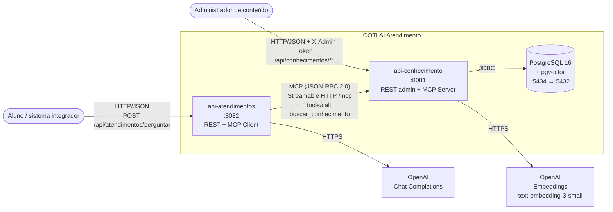
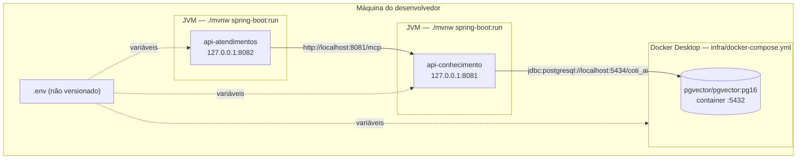
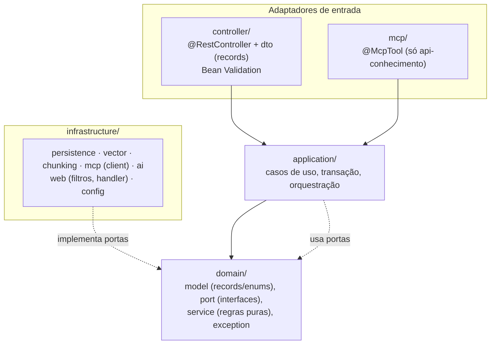
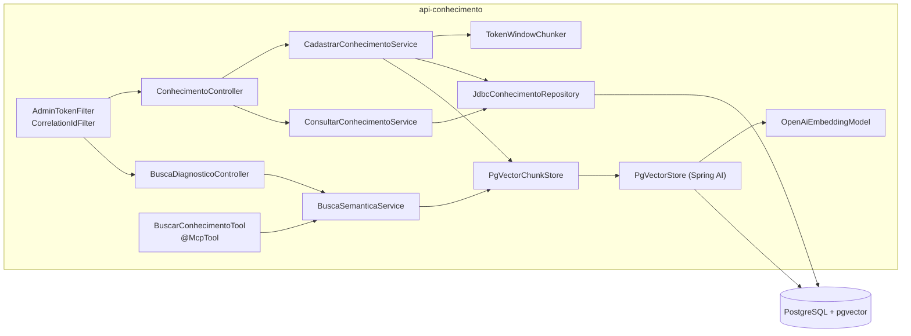
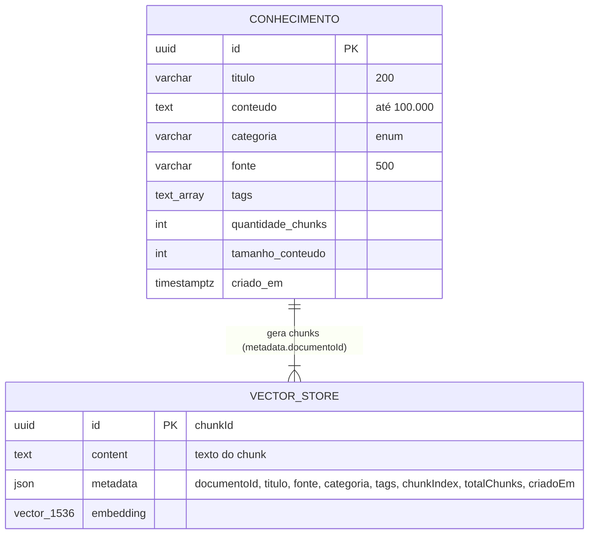
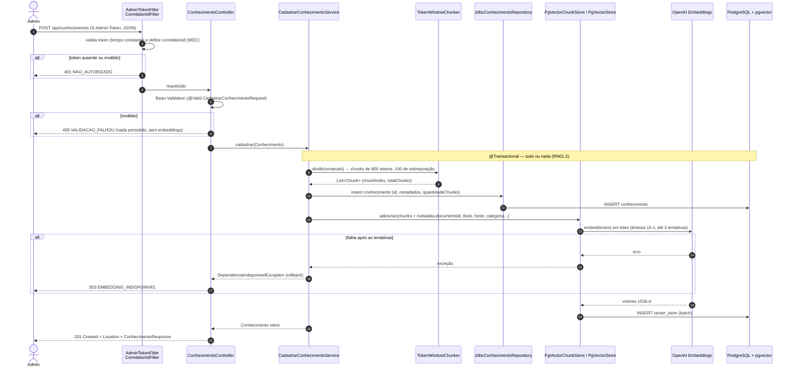
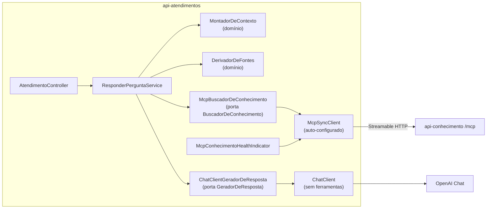
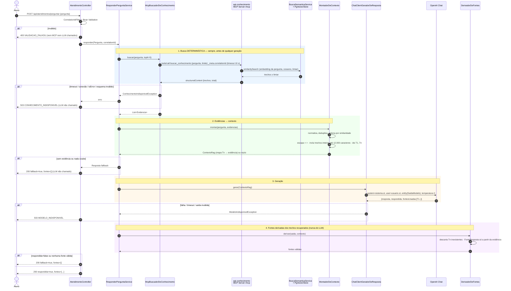

# Arquitetura — COTI AI Atendimento (MVP)

> Arquitetura **definitiva do MVP**. Subordinada a [`01-constitution.md`](01-constitution.md) e
> [`06-api-contracts.md`](06-api-contracts.md); implementa [`02-requirements.md`](02-requirements.md).
> As skills em `skills/` detalham o *como* de cada tecnologia. Quando uma skill divergir deste
> documento, este documento prevalece.

## 1. Visão geral

Dois microsserviços Spring Boot independentes, em um monorepo Maven:

| Serviço | Porta | Papel | Dependências externas |
|---|---|---|---|
| `api-conhecimento` | **8081** | Cadastro, chunking, embeddings, pgvector, busca semântica e **MCP Server** (`buscar_conhecimento`). | PostgreSQL 16 + pgvector; OpenAI (embeddings). |
| `api-atendimentos` | **8082** | API REST de perguntas, **MCP Client**, montagem do contexto RAG e geração da resposta com `ChatClient`. | `api-conhecimento` (só via MCP); OpenAI (chat). |

### 1.1 Diagrama de contexto



### 1.2 Implantação local (MVP)



No MVP, **somente o PostgreSQL roda em container**. As duas aplicações rodam na JVM do host,
iniciadas por `./mvnw spring-boot:run` dentro de cada serviço. A conteinerização das aplicações
fica fora do MVP (ADR-012).

---

## 2. Stack e versões

| Item | Versão / escolha | Observação |
|---|---|---|
| Java | **21** (LTS) | `maven.compiler.release=21`. |
| Spring Boot | **4.1.x**, fixado em **4.1.2** no scaffold (2026-10-25) | Parent `spring-boot-starter-parent`. O Spring AI 2.0.x suporta Boot 4.0.x e 4.1.x; a 4.1 tem a janela de suporte mais longa. |
| Spring AI | **2.0.1** | Via `spring-ai-bom` 2.0.1 importado em `dependencyManagement`. Nenhum artefato Spring AI com versão avulsa. |
| JSON | Jackson 3 (`tools.jackson`) | Padrão do Boot 4. |
| Banco | **PostgreSQL 16** + pgvector | Imagem `pgvector/pgvector:pg16`, porta local **5434** → 5432 no container. |
| Migrações | Flyway | `spring-boot-starter-flyway` + `flyway-database-postgresql`. Só na `api-conhecimento`. |
| Acesso a dados | `JdbcClient` (Spring JDBC) + `PgVectorStore` | Sem JPA (ADR-007). |
| Embeddings | OpenAI **`text-embedding-3-small`**, **1536** dimensões | Só na `api-conhecimento`. |
| Chat | OpenAI, modelo em `OPENAI_CHAT_MODEL` | Só na `api-atendimentos`. Padrão sugerido: `gpt-4o-mini`. |
| MCP | Starters do Spring AI 2.0.1, transporte **Streamable HTTP** | Server WebMVC, `protocol: STREAMABLE`; client `SYNC`. |
| OpenAPI | springdoc-openapi **3.1.1** (`springdoc-openapi-starter-webmvc-ui`) | A linha 3.x é a compatível com o Boot 4; a 3.1.1 é compilada sobre o Boot 4.1.0. O `swagger-annotations(-jakarta)` é fixado em **2.2.55** via `dependencyManagement`, porque o Spring AI (2.2.38) e o SDK da OpenAI (2.2.31) trazem versões antigas das mesmas classes, o que quebra o `/v3/api-docs` com `NoSuchMethodError` (Fase 8). |
| Observabilidade | Actuator, Micrometer, logs estruturados nativos do Boot (`logging.structured.format.console`) | |
| Testes | JUnit 5, Mockito, AssertJ, Spring Boot Test, Testcontainers 2.x (`org.testcontainers.postgresql.PostgreSQLContainer`) | Versões gerenciadas pelo Boot. |
| Build | Maven 3.9+, Maven Wrapper | |

### 2.1 Dependências por serviço

| Dependência | `api-conhecimento` | `api-atendimentos` |
|---|:-:|:-:|
| `spring-boot-starter-webmvc` | ✔ | ✔ |
| `spring-boot-starter-validation` | ✔ | ✔ |
| `spring-boot-starter-actuator` | ✔ | ✔ |
| `springdoc-openapi-starter-webmvc-ui` | ✔ | ✔ |
| `spring-ai-starter-model-openai` | ✔ (só embedding) | ✔ (só chat) |
| `spring-ai-starter-vector-store-pgvector` | ✔ | **✘ proibido** |
| `spring-boot-starter-flyway`, `flyway-database-postgresql`, `postgresql` | ✔ | **✘ proibido** |
| `spring-ai-starter-mcp-server-webmvc` | ✔ | ✘ |
| `spring-ai-starter-mcp-client` | ✘ | ✔ |
| `spring-boot-starter-test`, `spring-boot-testcontainers`, `testcontainers-postgresql`, `testcontainers-junit-jupiter` (test) | ✔ | ✔ (sem Testcontainers de banco) |

Os itens proibidos na `api-atendimentos` são verificados por teste (seção 10) e pelo
`maven-enforcer-plugin` (`bannedDependencies`), conforme a ADR-003.

---

## 3. Monorepo Maven

- O `pom.xml` da raiz é **apenas agregador** (`packaging=pom`, `<modules>`). Ele **não** é parent
  dos serviços.
- Cada serviço tem `spring-boot-starter-parent` como parent, o próprio `spring-ai-bom` e o próprio
  Maven Wrapper. Cada um compila, testa e roda sozinho (`cd api-xxx && ./mvnw verify`). O build da
  raiz (`./mvnw verify`) é só uma conveniência.
- Não existe módulo compartilhado de código entre os serviços (Art. 3). Os tipos que trafegam no
  MCP são definidos de forma independente em cada lado, a partir de `06-api-contracts.md`, e
  conferidos por testes de contrato.

### 3.1 Árvore de diretórios

```text
coti-ai-atendimento/
├── pom.xml                                  # agregador (packaging=pom), não é parent
├── mvnw, mvnw.cmd, .mvn/                    # wrapper para o build agregado
├── .env.example                             # todas as variáveis, sem valores
├── .gitignore                               # inclui .env
├── AGENTS.md
├── infra/
│   └── docker-compose.yml                   # postgres (pgvector/pgvector:pg16), 5434:5432
├── specs/                                   # 01..08
├── skills/                                  # spring-ai, mcp-integration, rag-pgvector, testing
│
├── api-conhecimento/
│   ├── pom.xml                              # parent: spring-boot-starter-parent 4.1.x
│   ├── mvnw, mvnw.cmd, .mvn/
│   └── src/
│       ├── main/
│       │   ├── java/br/com/coti/conhecimento/
│       │   │   ├── ApiConhecimentoApplication.java
│       │   │   ├── controller/              # @RestController (adaptadores de entrada REST)
│       │   │   │   ├── ConhecimentoController.java
│       │   │   │   ├── BuscaDiagnosticoController.java
│       │   │   │   └── dto/                 # records: CadastrarConhecimentoRequest, ConhecimentoResponse,
│       │   │   │                            #   ConhecimentoResumo, PaginaConhecimentos, BuscaSemanticaRequest,
│       │   │   │                            #   BuscaSemanticaResponse, TrechoConhecimento, ErroResponse
│       │   │   ├── mcp/                     # adaptador de entrada MCP
│       │   │   │   ├── BuscarConhecimentoTool.java      # @McpTool buscar_conhecimento
│       │   │   │   └── dto/                 # records: ResultadoBuscaMcp, TrechoMcp, ErroMcp
│       │   │   ├── application/             # casos de uso (orquestração, transação)
│       │   │   │   ├── CadastrarConhecimentoService.java
│       │   │   │   ├── ConsultarConhecimentoService.java
│       │   │   │   └── BuscaSemanticaService.java
│       │   │   ├── domain/
│       │   │   │   ├── model/               # records/enums: Conhecimento, Categoria, Chunk, ConsultaBusca, Trecho
│       │   │   │   ├── port/                # interfaces: ConhecimentoRepository, ChunkStore, Chunker
│       │   │   │   └── exception/           # ConhecimentoNaoEncontradoException, DependenciaIndisponivelException...
│       │   │   └── infrastructure/
│       │   │       ├── persistence/         # JdbcConhecimentoRepository (JdbcClient)
│       │   │       ├── vector/              # PgVectorChunkStore (VectorStore + SearchRequest)
│       │   │       ├── chunking/            # TokenWindowChunker (janela de tokens com sobreposição)
│       │   │       ├── web/                 # CorrelationIdFilter, AdminTokenFilter, GlobalExceptionHandler
│       │   │       └── config/              # @ConfigurationProperties (records), OpenApiConfig
│       │   └── resources/
│       │       ├── application.yml
│       │       ├── application-dev.yml      # log de conteúdo opcional, só em dev
│       │       └── db/migration/
│       │           ├── V1__extensoes.sql
│       │           ├── V2__conhecimento.sql
│       │           └── V3__vector_store.sql
│       └── test/java/br/com/coti/conhecimento/
│           ├── domain/ application/ infrastructure/    # *Test (unitários)
│           ├── controller/                              # *Test (@WebMvcTest)
│           ├── it/                                      # *IT (Testcontainers + MCP)
│           └── support/                                 # FakeEmbeddingModel, PostgresTestcontainersConfig
│
└── api-atendimentos/
    ├── pom.xml                              # parent: spring-boot-starter-parent 4.1.x (sem banco)
    ├── mvnw, mvnw.cmd, .mvn/
    └── src/
        ├── main/
        │   ├── java/br/com/coti/atendimentos/
        │   │   ├── ApiAtendimentosApplication.java
        │   │   ├── controller/
        │   │   │   ├── AtendimentoController.java
        │   │   │   └── dto/                 # records: PerguntaRequest, RespostaAtendimentoResponse,
        │   │   │                            #   FonteResposta, ErroResponse
        │   │   ├── application/
        │   │   │   └── ResponderPerguntaService.java    # orquestra o fluxo B
        │   │   ├── domain/
        │   │   │   ├── model/               # records: Pergunta, Evidencia, ContextoRag, TrechoContexto,
        │   │   │   │                        #   SaidaModelo, Fonte, Resposta, Desfecho (enum)
        │   │   │   ├── port/                # BuscadorDeConhecimento, GeradorDeResposta
        │   │   │   ├── service/             # MontadorDeContexto, DerivadorDeFontes (regras puras, sem Spring)
        │   │   │   └── exception/           # ConhecimentoIndisponivelException, ModeloIndisponivelException
        │   │   └── infrastructure/
        │   │       ├── mcp/                 # McpBuscadorDeConhecimento, McpConhecimentoHealthIndicator, dto/
        │   │       ├── ai/                  # ChatClientGeradorDeResposta, ChatClientConfig
        │   │       ├── web/                 # CorrelationIdFilter, GlobalExceptionHandler
        │   │       └── config/              # @ConfigurationProperties (records), OpenApiConfig
        │   └── resources/
        │       ├── application.yml
        │       ├── application-dev.yml
        │       └── prompts/
        │           ├── sistema.st
        │           └── usuario.st
        └── test/java/br/com/coti/atendimentos/
            ├── domain/ application/ infrastructure/    # *Test
            ├── controller/                              # *Test (@WebMvcTest)
            ├── it/                                      # *IT (servidor MCP de teste + ChatModel simulado)
            └── support/                                 # FakeMcpServerApplication, StubChatModel
```

---

## 4. Camadas



| Camada | Pode depender de | Não pode depender de |
|---|---|---|
| `controller/`, `mcp/` | `application`, `domain.model`, os próprios `dto` | `infrastructure`, `VectorStore`, `ChatClient`, JDBC |
| `application/` | `domain` (model, port, service, exception) | `controller`, `infrastructure`, classes de framework web |
| `domain/` | JDK, e Spring AI `Document` **apenas** nas portas da `api-conhecimento` quando inevitável (preferir os próprios records) | Spring Web, JDBC, MCP SDK, `ChatClient`, Jackson |
| `infrastructure/` | `domain`, Spring, Spring AI, MCP SDK, JDBC | `controller`, `application` (exceto `config` que monta beans) |

**Regras:**
- **DTOs** de entrada e saída são `record`s em `controller/dto` e `mcp/dto`. Eles **não** chegam
  ao domínio: o controller converte para o modelo de domínio.
- **Bean Validation** fica nos `record`s de requisição (`@NotBlank`, `@Size`, `@NotNull`, `@Min`,
  `@Max`, `@Valid`), com `@Validated` nos controllers para parâmetros de consulta e de caminho. Os
  argumentos MCP são validados no próprio `@McpTool`, convertidos em `ConsultaBusca`, com as
  mesmas regras centralizadas no record de domínio.
- **Injeção por construtor**, com campos `final`. Não se usa `@Autowired` em campo.
- **Configuração tipada** com `@ConfigurationProperties` em `record`s validados
  (`@Validated`), por exemplo `RagProperties`, `ChunkingProperties`, `AdminProperties`. Valor
  inválido impede a inicialização (CA02.4).
- **Erros:** um `@RestControllerAdvice` (`GlobalExceptionHandler`) por serviço converte as
  exceções em `ProblemDetail`, com as extensões `codigo`, `correlationId`, `timestamp` e `erros`
  (`06-api-contracts.md`, seção 2).
- **Verificação das camadas:** testes ArchUnit em cada serviço (ADR-013).

---

## 5. `api-conhecimento`

### 5.1 Componentes



### 5.2 Modelo de dados



- A tabela `conhecimento` guarda o documento integral, para as consultas `GET /api/conhecimentos`
  e `GET /api/conhecimentos/{id}`. Ela tem um índice em `(categoria, criado_em DESC)`.
- A tabela `vector_store` usa o esquema esperado pelo `PgVectorStore` (id, content, metadata,
  embedding), criado **por migração**, com `initialize-schema: false`.
- O índice vetorial é **HNSW** com `vector_cosine_ops`. As extensões `vector`, `hstore` e
  `uuid-ossp` ficam na `V1`. O DDL exato da `vector_store` DEVE ser conferido na documentação do
  PgVector do Spring AI 2.0.1 (Context7) ao escrever a `V3`.
- O vínculo chunk → documento fica em `metadata.documentoId`. Não há chave estrangeira, porque o
  esquema da `vector_store` pertence ao `PgVectorStore`. A atomicidade é garantida pela transação
  (seção 5.4).

### 5.3 Configuração principal (`application.yml`)

```yaml
server:
  port: 8081
  address: ${SERVER_ADDRESS:127.0.0.1}

spring:
  application.name: api-conhecimento
  threads.virtual.enabled: true
  datasource:
    url: jdbc:postgresql://${POSTGRES_HOST:localhost}:${POSTGRES_PORT:5434}/${POSTGRES_DB}
    username: ${POSTGRES_USER}
    password: ${POSTGRES_PASSWORD}
    hikari:
      connection-timeout: 5000                # ms (propriedade numérica do HikariCP)
  ai:
    model:
      chat: none                              # este serviço não gera texto
    openai:
      api-key: ${OPENAI_API_KEY}
      timeout: ${OPENAI_EMBEDDING_TIMEOUT:15s} # cliente oficial da OpenAI (Spring AI 2.0)
      max-retries: 2                          # retentativas do SDK (até 3 tentativas); spring.ai.retry não se aplica
      embedding.options:
        model: ${OPENAI_EMBEDDING_MODEL:text-embedding-3-small}
        dimensions: 1536
    vectorstore.pgvector:
      initialize-schema: false
      schema-validation: true
      dimensions: 1536
      distance-type: COSINE_DISTANCE
      index-type: HNSW
    mcp.server:
      protocol: STREAMABLE
      name: api-conhecimento
      version: 1.0.0
      type: SYNC
      streamable-http.mcp-endpoint: /mcp

coti:
  admin.token: ${ADMIN_API_TOKEN}
  chunking:
    tamanho-tokens: ${CHUNK_SIZE:800}
    sobreposicao-tokens: ${CHUNK_OVERLAP:100}
  rag:
    limiar-similaridade: ${RAG_SIMILARITY_THRESHOLD:0.38}
    top-k-padrao: 5
    top-k-maximo: 10

logging.structured.format.console: ${LOG_FORMAT:ecs}
management:
  endpoints.web.exposure.include: health,info,metrics
  endpoint.health:
    show-details: never
    show-components: always
```

Este bloco é a referência para a implementação. Os nomes das propriedades do Spring AI foram
conferidos nos metadados do `spring-ai-autoconfigure-model-openai` 2.0.1 (Fase 4). No 2.0, o starter
da OpenAI usa o SDK oficial `openai-java`: o timeout (`OPENAI_EMBEDDING_TIMEOUT`, 15 s) é
`spring.ai.openai.timeout`, e as tentativas são `spring.ai.openai.max-retries`.

### 5.4 Fluxo A — Ingestão

`REST → validação → chunking → embeddings → pgvector`



**Decisões do fluxo A:**

- **Chunking com sobreposição:** o `TokenTextSplitter` do Spring AI 2.0 **não oferece
  sobreposição**. Por isso o `TokenWindowChunker` (porta `Chunker`, implementação em
  `infrastructure/chunking`) aplica uma janela deslizante de tokens: tamanho 800, passo 700, com o
  codificador `cl100k_base` da biblioteca `jtokkit`, que já vem como dependência transitiva do
  Spring AI. As fronteiras são ajustadas para não cortar caracteres multibyte nem palavras. Os
  testes cobrem RN02.1–RN02.4.
- **Atomicidade:** o `INSERT` em `conhecimento` e o `vectorStore.add(...)` usam o mesmo
  `DataSource` dentro de um `@Transactional`. O `PgVectorStore` usa `JdbcTemplate`, que participa
  da transação. Se os embeddings ou o insert falharem, há rollback completo (CA03.2).
- **Custo aceito no MVP:** a transação fica aberta durante as chamadas de embedding (até
  3 × 15 s). Isso é aceitável para o volume do MVP. A evolução seria gerar os embeddings antes de
  abrir a transação (ADR-008).
- O log registra o `documentoId`, a categoria, o tamanho, a quantidade de chunks e a latência,
  nunca o conteúdo.

### 5.5 Busca semântica e ferramenta MCP

- O `BuscaSemanticaService.buscar(ConsultaBusca)` é a **única** implementação de busca. Ele é
  usado pela ferramenta MCP e pelo endpoint de diagnóstico, que seguem as mesmas regras.
- A busca é feita com `SearchRequest.builder().query(pergunta).topK(limite).similarityThreshold(limiar).build()`,
  e cada `Document` é convertido em `Trecho`, com `similaridade` vinda de `Document.getScore()`.
  Nada abaixo do limiar é devolvido.
- **Decisão da Fase 5: a ferramenta é registrada de forma programática, não com `@McpTool`.**
  - **Motivo:** o `@McpToolParam` não expressa `minLength`, `maxLength`, `minimum`, `maximum` nem
    `default`. Além disso, devolver `isError = true` com `structuredContent.erro` exige um
    `CallToolResult`, o que anula o `generateOutputSchema`.
  - `mcp/BuscarConhecimentoTool` monta um `McpSchema.Tool` a partir de
    `resources/mcp/buscar_conhecimento.json` (cópia literal da seção 4.2 do contrato) e expõe um
    `McpServerFeatures.SyncToolSpecification`.
  - O `mcp/McpFerramentasConfig` publica a lista de especificações para a auto-configuração.
  - O handler lê o `_meta.correlationId` direto do `CallToolRequest.meta()` e o coloca no MDC.
- **Validação de argumentos:** a validação genérica do SDK MCP 2.0 (`validateToolInputs`, que
  responde só com texto) é desligada por um `McpSyncServerCustomizer`. Ele é `@Primary` e delega ao
  `servletMcpSyncServerCustomizer` da auto-configuração, que aceita um único customizer. Assim, toda
  entrada inválida passa pelas regras de `ConsultaBusca` e da ferramenta (argumento desconhecido,
  tipo errado, faixa) e volta com `erro.codigo = ARGUMENTO_INVALIDO`, conforme a seção 4.5.
- O retorno de sucesso é o `record` `ResultadoBuscaMcp`, entregue como `structuredContent`, com o
  mesmo JSON em `content[0]`.
- **Teste de contrato:** o `McpToolContractIT` lê o bloco JSON da seção 4.2 **direto de
  `specs/06-api-contracts.md`** e o compara com o `tools/list` real. Foi verificado que o teste falha
  quando o esquema publicado diverge.

---

## 6. `api-atendimentos`

### 6.1 Componentes



### 6.2 Configuração principal (`application.yml`)

```yaml
server:
  port: 8082
  address: ${SERVER_ADDRESS:127.0.0.1}

spring:
  application.name: api-atendimentos
  threads.virtual.enabled: true
  ai:
    model:
      embedding: none                         # Art. 6 — nenhum EmbeddingModel aqui
    openai:
      api-key: ${OPENAI_API_KEY}
      timeout: ${OPENAI_CHAT_TIMEOUT:30s}     # cliente oficial da OpenAI (Spring AI 2.0)
      max-retries: 2                          # até 3 tentativas
      chat.options:
        model: ${OPENAI_CHAT_MODEL:gpt-4o-mini}
        temperature: 0.0
    mcp.client:
      name: api-atendimentos
      type: SYNC
      request-timeout: ${MCP_REQUEST_TIMEOUT:10s}
      initialized: false                      # sobe mesmo com a api-conhecimento fora do ar
      toolcallback.enabled: false             # a ferramenta NÃO é entregue ao LLM (ADR-005)
      streamable-http.connections:
        conhecimento:
          url: ${MCP_CONHECIMENTO_URL}        # ex.: http://localhost:8081 (endpoint padrão /mcp)

coti:
  rag:
    top-k: ${RAG_TOP_K:5}
    contexto-max-caracteres: ${RAG_CONTEXTO_MAX_CARACTERES:12000}
  atendimento:
    mensagem-fallback: ${ATENDIMENTO_MENSAGEM_FALLBACK:Não encontrei essa informação na base de conhecimento da COTI. Para dúvidas sobre esse assunto, entre em contato com o atendimento da COTI Informática.}

logging.structured.format.console: ${LOG_FORMAT:ecs}
management:
  endpoints.web.exposure.include: health,info,metrics
  endpoint.health:
    show-details: never
    show-components: always
```

O timeout do chat (`OPENAI_CHAT_TIMEOUT`, 30 s por tentativa) é aplicado como no item 5.3.

### 6.3 Fluxo B — Atendimento

`REST → MCP → busca vetorial → evidências → prompt → OpenAI → resposta`



**Regra central do fluxo B:** a ferramenta MCP `buscar_conhecimento` executa a busca vetorial
**antes** da geração da resposta, **sempre**, chamada **pela aplicação**
(`ResponderPerguntaService` → `McpBuscadorDeConhecimento` → `McpSyncClient.callTool`). O LLM não
recebe ferramentas e não decide se busca (ADR-005). As regras de contexto, prompt, fallback e
derivação de fontes seguem `06-api-contracts.md`, seção 6.

**Implementação do cliente MCP** (como implementado na Fase 6):
- O `ConexaoMcpConhecimento` encapsula o único `McpSyncClient` (conexão `conhecimento`). Na
  primeira chamada, executa `initialize()` de forma preguiçosa (com um `ReentrantLock`, para não
  fixar virtual threads) e confere com `listTools()` que `buscar_conhecimento` existe; a
  confirmação positiva fica em cache. Ele é compartilhado pelo buscador e pelo health indicator,
  que usa `verificar()` com `ping`.
- O `McpBuscadorDeConhecimento` monta o `CallToolRequest` com `arguments` (`pergunta`,
  `limite = RAG_TOP_K`) e `_meta.correlationId` (do MDC). Ele lê `structuredContent` (ou o JSON de
  `content[0]` como alternativa) e exige o array `trechos`. Itens sem campo obrigatório ou com UUID
  inválido são **descartados** e contados em log.
- Qualquer falha vira `ConhecimentoIndisponivelException`, com o motivo `TIMEOUT`, `CONEXAO`,
  `ERRO_DA_FERRAMENTA`, `FERRAMENTA_AUSENTE` ou `RESPOSTA_INVALIDA`. Uma falha nunca é tratada
  como lista vazia.
- O `ResponderPerguntaService` (camada de aplicação, sem anotações Spring) é montado em
  `infrastructure.config.ServicosConfig` com `topK` e a mensagem de fallback, para que a aplicação
  não dependa da infraestrutura.
- O `correlationId` do corpo da resposta vem de um atributo da requisição definido pelo
  `CorrelationIdFilter`, o mesmo valor do cabeçalho e do MDC.
- **Testes:** um `FakeMcpServer` (aplicação Spring separada, pacote `br.com.coti.fakemcp`, fora do
  scan da aplicação, starter de MCP Server só com escopo `test`) simula respostas, erro, atraso,
  esquema inválido e ferramenta ausente. A aplicação de teste aponta para a porta 1 por padrão, e
  `spring.ai.mcp.server.enabled=false` impede que ela própria exponha um MCP Server.

**Implementação do gerador** (como implementado na Fase 7):
- O `ChatClient` é criado uma vez (`ChatClientConfig`), com `defaultSystem(sistema.st)` e **sem**
  `defaultTools`.
- A chamada é
  `chatClient.prompt().user(u -> u.text(usuario.st).params(...)).call().responseEntity(SaidaModelo.class)`,
  em que `SaidaModelo` é um `record(String resposta, boolean respondida, List<String> fontesUsadas)`.
  Os trechos e a pergunta entram como **parâmetros** do template, nunca concatenados. O
  `ChatResponse` fornece o uso de tokens para o log.
- **Exceções:** com o SDK oficial da OpenAI no Spring AI 2.0, os erros do provedor não são
  necessariamente `TransientAiException` ou `NonTransientAiException`. Por isso **qualquer**
  `RuntimeException` da chamada (erro do provedor, tentativas esgotadas, timeout, conversão da saída
  estruturada) e uma entidade nula viram `ModeloIndisponivelException` → `503 MODELO_INDISPONIVEL`.
  As tentativas ficam a cargo do SDK (`max-retries: 2`, ou seja, até 3 tentativas).
- **Domínio puro:** `MontadorDeContexto` (normalização, escape de `<`, `>` e aspas, limite de
  12.000 caracteres sem truncar, ids `Tn`) e `DerivadorDeFontes` (fontes só das evidências, ids
  inexistentes descartados) são classes sem Spring, montadas em `ServicosConfig`.
- **Modelos não usados desligados:** o starter da OpenAI 2.0 também cria modelos de áudio, imagem e
  moderação. Os dois serviços os desligam com `spring.ai.model.{audio.speech, audio.transcription,
  image, moderation}=none`.
- **Quebras de linha:** o `PromptTemplate` (StringTemplate) escreve as quebras de linha com o
  separador da plataforma (`\r\n` no Windows), o que é inofensivo para o modelo.

---

## 7. Observabilidade

| Item | Decisão |
|---|---|
| Id de correlação | O `CorrelationIdFilter` lê `X-Correlation-Id` (UUID válido) ou gera um, coloca no MDC (`correlationId`) e devolve no cabeçalho. A `api-atendimentos` propaga o id para a `api-conhecimento` via `_meta.correlationId` no MCP, e o servidor também o coloca no MDC. |
| Logs | Formato estruturado **ECS** (`logging.structured.format.console=ecs`). As chaves do MDC entram no JSON. No perfil `dev`, `LOG_FORMAT` pode ser vazio, para texto legível. |
| O que registrar | Metadados: tamanho da pergunta, quantidade de trechos recebidos, incluídos e descartados, `chunkId`s usados, similaridades, tamanho do contexto, tokens (do `ChatResponse` metadata), latência por etapa e desfecho (`RESPONDIDA`, `FALLBACK` ou código de erro). |
| O que **não** registrar | Pergunta, trechos, resposta, conteúdo de documentos, tokens, chaves, senhas. Nenhum código registra conteúdo, em nenhum perfil. Por isso o "log de conteúdo em dev" previsto inicialmente **não foi implementado** (decisão da Fase 8, regra 3 do AGENTS.md: sem funcionalidade, não há o que proteger com guarda). Se um dia for necessário, ele entra junto com a guarda de perfil `dev`. A ausência de conteúdo nos logs é verificada pelo `LogSeguroIT` e pelo `AtendimentoFluxoIT`. |
| Métricas | Micrometer, com instrumentação nativa do Spring AI (chat, embedding, vector store), mais as métricas próprias da `api-atendimentos`: `coti.atendimento.desfecho{tipo=RESPONDIDA|FALLBACK|CONHECIMENTO_INDISPONIVEL|MODELO_INDISPONIVEL|ERRO_INTERNO}`, `coti.atendimento.fontes.descartadas`, `coti.mcp.chamada{resultado=SUCESSO|<motivo>}` e o timer `coti.atendimento.etapa{etapa=mcp|modelo|total}`. A aplicação usa a porta de domínio `MetricasAtendimento` (implementada por `infrastructure.metrics.MicrometerMetricasAtendimento`); os adaptadores MCP e de IA medem as próprias etapas. |
| Health | `api-conhecimento`: `db`, `diskSpace`, `ping`. `api-atendimentos`: `mcpConhecimento` (`McpConhecimentoHealthIndicator`: ping/`listTools` com timeout de 2 s e cache de 10 s), `diskSpace`, `ping`. Mostra os componentes sem detalhes. |
| Tracing | Micrometer Observation está ativo. A propagação de trace W3C pelo transporte MCP **não é garantida no MVP**. Por isso o `correlationId` é a chave de rastreabilidade entre os serviços. A exportação OTLP fica fora do MVP. |
| OpenAPI | springdoc nos dois serviços: `/v3/api-docs` e `/swagger-ui.html`. A documentação vem das anotações nos controllers e records (`@Operation`, `@ApiResponse`, `@Schema` com exemplos do contrato). O endpoint `/mcp` é excluído do OpenAPI (`springdoc.paths-to-exclude=/mcp/**`). |

---

## 8. Segurança

### 8.1 Mínimo obrigatório no MVP (ambiente local)

| Medida | Como |
|---|---|
| Segredos fora do código | Todas as credenciais vêm de variáveis de ambiente lidas do `.env`, que não é versionado. O `.env.example` traz as variáveis sem valor. Variável obrigatória ausente impede a inicialização. |
| Token administrativo | O `AdminTokenFilter` protege `/api/conhecimentos/**` comparando `X-Admin-Token` com `ADMIN_API_TOKEN` via `MessageDigest.isEqual`. Responde `401` sem detalhes e nunca loga o valor. Não usa Spring Security no MVP (ADR-010). |
| Bind local | `server.address=127.0.0.1` por padrão (`SERVER_ADDRESS`), então o MCP Server e as APIs não ficam acessíveis pela rede local. |
| PostgreSQL | Publicado só em `127.0.0.1:5434`, com usuário e senha do `.env`. |
| Erros sem vazamento | `ProblemDetail` com mensagens genéricas, sem stack trace, SQL, URL interna ou mensagem do provedor (`server.error.include-stacktrace=never`). |
| Actuator restrito | Só `health`, `info` e `metrics` são expostos, com health sem detalhes. |
| Limite de entrada | Bean Validation nos tamanhos, e `server.tomcat.max-http-form-post-size` / limite de corpo compatível com 100.000 caracteres. |
| LLM sem ferramentas | O `ChatClient` não tem ferramentas, então uma injeção de prompt não consegue disparar ações (Art. 10). |
| Prompt injection | Escape de `<`/`>`, delimitadores, ids `Tn`, validação de fontes e prompt de sistema restritivo (`06-api-contracts.md`, seção 6). |

### 8.2 Obrigatório antes de publicar em rede

| Medida | Detalhe |
|---|---|
| TLS | HTTPS em todo tráfego externo, terminado em um gateway ou proxy reverso. |
| Autenticação administrativa forte | Trocar o token estático por OAuth2/OIDC (Spring Security Resource Server com JWT), com perfis e auditoria de quem cadastrou cada conhecimento. |
| MCP Server isolado | `/mcp` acessível **somente** pela rede interna dos serviços, sem exposição no gateway, e com autenticação de serviço a serviço (OAuth2 client credentials, conforme a autorização do MCP, ou mTLS). |
| Rate limiting e cotas | No gateway, por IP e por cliente, em `/api/atendimentos/perguntar`, para proteger o custo da OpenAI. |
| CORS | Lista explícita de origens dos sistemas integradores. |
| Gestão de segredos | Cofre (ex.: Vault ou o secret manager da nuvem) em vez de `.env`, com rotação da chave da OpenAI e do token. |
| Banco | Usuário de aplicação com privilégio mínimo (sem DDL; as migrações rodam com um usuário separado), rede privada, backups. |
| Actuator e Swagger | Actuator em porta de gerenciamento separada e não pública. Swagger UI desabilitado em produção (`springdoc.swagger-ui.enabled=false`). |
| Cadeia de dependências | Varredura de vulnerabilidades (OWASP Dependency-Check ou equivalente) e de segredos (gitleaks) no pipeline. |
| LGPD | Política de retenção de logs, aviso ao aluno de que as perguntas são processadas por um provedor externo, e revisão de dados pessoais. |

---

## 9. Configuração por variáveis de ambiente

| Variável | Serviço | Obrigatória | Padrão |
|---|---|:-:|---|
| `OPENAI_API_KEY` | ambos | ✔ | — |
| `OPENAI_CHAT_MODEL` | atendimentos | | `gpt-4o-mini` |
| `OPENAI_CHAT_TIMEOUT` | atendimentos | | `30s` |
| `OPENAI_EMBEDDING_MODEL` | conhecimento | | `text-embedding-3-small` |
| `OPENAI_EMBEDDING_TIMEOUT` | conhecimento | | `15s` |
| `POSTGRES_HOST` | conhecimento | | `localhost` |
| `POSTGRES_PORT` | conhecimento / compose | | `5434` (porta do host) |
| `POSTGRES_DB`, `POSTGRES_USER`, `POSTGRES_PASSWORD` | conhecimento / compose | ✔ | — |
| `ADMIN_API_TOKEN` | conhecimento | ✔ | — |
| `CHUNK_SIZE`, `CHUNK_OVERLAP` | conhecimento | | `800`, `100` |
| `RAG_SIMILARITY_THRESHOLD` | conhecimento | | `0.38` (calibrado, ADR-014) |
| `MCP_CONHECIMENTO_URL` | atendimentos | ✔ | — (local: `http://localhost:8081`) |
| `MCP_REQUEST_TIMEOUT` | atendimentos | | `10s` |
| `RAG_TOP_K` | atendimentos | | `5` |
| `RAG_CONTEXTO_MAX_CARACTERES` | atendimentos | | `12000` |
| `ATENDIMENTO_MENSAGEM_FALLBACK` | atendimentos | | texto do contrato |
| `SERVER_ADDRESS` | ambos | | `127.0.0.1` |
| `LOG_FORMAT` | ambos | | `ecs` |

### 9.1 `infra/docker-compose.yml` (especificação)

| Item | Valor |
|---|---|
| Serviço | `postgres` |
| Imagem | `pgvector/pgvector:pg16` |
| Portas | `127.0.0.1:${POSTGRES_PORT:-5434}:5432` |
| Ambiente | Somente `POSTGRES_DB`, `POSTGRES_USER` e `POSTGRES_PASSWORD`, interpolados do `.env` via `--env-file`. Não se usa `env_file`, para que as outras credenciais, como a `OPENAI_API_KEY`, não entrem no container. |
| Volume | Volume nomeado `coti-pgdata` em `/var/lib/postgresql/data` |
| Healthcheck | `pg_isready -U $POSTGRES_USER -d $POSTGRES_DB`, intervalo de 5 s |
| Extensões | Criadas pelas migrações Flyway (`V1`), não pelo container |

Comandos de referência: `docker info` para confirmar o Docker Desktop e, na raiz,
`docker compose -f infra/docker-compose.yml --env-file .env up -d`.

---

## 10. Estratégia de testes

| Nível | `api-conhecimento` | `api-atendimentos` |
|---|---|---|
| Unitário (`*Test`, Surefire) | `TokenWindowChunker` (RN02.x), validação de `ConsultaBusca`, `CadastrarConhecimentoService` com portas mockadas, conversão `Document → Trecho`. | `MontadorDeContexto` (escape, limite de 12.000 sem truncar, ids `Tn`, dedupe, ordem), `DerivadorDeFontes` (descarte de ids inválidos), `ResponderPerguntaService` (todos os desfechos), prompt com `ArgumentCaptor`. |
| Fatia web (`@WebMvcTest`) | Controllers: `401` antes da validação, `400`, `201` + `Location`, paginação, `404`, formato `ProblemDetail`. | Controller: `400`, `200` fundamentada e fallback, `503` com os dois códigos. |
| Integração (`*IT`, Failsafe) | Testcontainers `pgvector/pgvector:pg16` com `@ServiceConnection` e `FakeEmbeddingModel` determinístico (1536 d): migrações do zero, cadastro atômico (falha no meio → nada persistido), busca com limiar, `GET` listagem e por id. | `FakeMcpServerApplication` (MCP Server de teste em porta aleatória, com respostas e falhas programadas: vazio, `isError`, atraso maior que o timeout, esquema inválido) e `StubChatModel`: fluxo B ponta a ponta. |
| Contrato MCP | `tools/list` e `tools/call` contra o servidor real (RANDOM_PORT + Testcontainers), comparados com a seção 4 do contrato. | Leitura de `structuredContent` e do fallback `content[0]` conforme o contrato. |
| Contrato REST / OpenAPI | `/v3/api-docs` contém só os endpoints da seção 3 e não contém `/mcp`. | `/v3/api-docs` contém só os endpoints da seção 5. |
| Arquitetura (ArchUnit) | Regras de camadas da seção 4. | Regras de camadas, mais: nenhuma classe em `org.springframework.jdbc`, `javax.sql`, `org.springframework.ai.vectorstore`, `org.springframework.ai.embedding`. |
| Adversarial | — | Documentos com instruções maliciosas e `</contexto>`, pedido do prompt de sistema, preço inexistente. Verificação determinística com modelo simulado (RNF08.5). |

Nenhum teste usa a OpenAI real (`spring.ai.openai.api-key=test-key` no perfil de teste). O comando
padrão é `./mvnw verify` em cada serviço. Os testes `*IT` da `api-conhecimento` exigem o Docker
Desktop ativo.

---

## 11. Decisões arquiteturais (ADRs)

| ADR | Decisão | Alternativas descartadas | Consequências |
|---|---|---|---|
| **ADR-001** Monorepo com projetos independentes | Um repositório, um agregador Maven sem herança, cada serviço com parent Boot, BOM e wrapper próprios. | Multi-repo; parent comum com módulo compartilhado. | Build e versionamento independentes, sem acoplamento por código, com specs e skills num só lugar. O custo é a duplicação de pequenos trechos de configuração. |
| **ADR-002** Spring Boot 4.1.x + Spring AI 2.0.1 + Java 21 | A linha 4.1, suportada pelo Spring AI 2.0.x e com janela de suporte maior. | Boot 4.0.x, também compatível, mas com suporte OSS mais curto. | Exige springdoc 3.x, Jackson 3 e Testcontainers 2.x. Se surgir incompatibilidade, voltar para 4.0.x é uma decisão registrada aqui. |
| **ADR-003** pgvector e embeddings só na `api-conhecimento` | A `api-atendimentos` não tem dependências de banco, vetor ou embedding. Isso é verificado por enforcer e ArchUnit. | Atendimentos consultar a base diretamente. | Cumpre os Art. 5 e 6. Toda evolução de busca acontece em um único serviço. |
| **ADR-004** MCP Streamable HTTP como única integração | MCP Server WebMVC (`STREAMABLE`) e client `SYNC`. | REST interno; SSE (depreciado no 2.0); STDIO. | Contrato padronizado e descobrível. Exige testes de contrato MCP e cuidado com timeouts. |
| **ADR-005** Invocação MCP **determinística** | A aplicação sempre chama `buscar_conhecimento` antes da geração. `toolcallback.enabled=false`, e o `ChatClient` fica sem ferramentas. | Registrar a ferramenta no `ChatClient` e deixar o LLM decidir se a chama. | Busca garantida em 100% das perguntas, fallback sem custo de LLM quando não há evidência, menos tokens, comportamento testável e nenhuma ferramenta disponível para uma injeção de prompt. Perde-se a busca iterativa ou reformulada pelo LLM, que fica fora do MVP. |
| **ADR-006** Fontes derivadas, ids locais `Tn` | O modelo vê apenas `T1…Tn`; as fontes são montadas a partir dos trechos recuperados. | Pedir ao modelo os UUIDs ou metadados das fontes. | O modelo não consegue inventar metadados, e um id inexistente é descartado. |
| **ADR-007** `JdbcClient` em vez de JPA | A tabela `conhecimento` é acessada com `JdbcClient`, no mesmo `DataSource` do `PgVectorStore`. | Spring Data JPA. | Menos dependências e transação simples com o `PgVectorStore`. As consultas SQL são escritas à mão (são poucas). |
| **ADR-008** Cadastro síncrono e atômico | O chunking, os embeddings e a persistência acontecem numa transação. | Fila ou processamento assíncrono. | Mais simples, e o `201` significa "pesquisável". A conexão fica presa durante os embeddings, o que é aceitável no volume do MVP. |
| **ADR-009** Chunker próprio com sobreposição | Janela deslizante de tokens (`jtokkit`, `cl100k_base`), com 800 de tamanho e 100 de sobreposição. | `TokenTextSplitter`, que não tem sobreposição no 2.0. | Atende o RF02. Exige testes próprios de fronteira e de reconstrução do texto. |
| **ADR-010** Token administrativo sem Spring Security | Um filtro simples com comparação em tempo constante. | Spring Security já no MVP. | Mínimo adequado para uso local. A troca por OAuth2 é obrigatória antes de publicar (seção 8.2). |
| **ADR-011** Erros RFC 9457 | `ProblemDetail` nativo do Spring, com extensões. | Formato próprio. | Padrão de mercado, com suporte nativo e documentado no OpenAPI. |
| **ADR-012** Apenas o PostgreSQL em container | As aplicações rodam na JVM local. | Compose com as três peças. | Ciclo de desenvolvimento mais rápido. A conteinerização das aplicações fica pós-MVP. |
| **ADR-013** ArchUnit para camadas e proibições | Testes de arquitetura em cada serviço. | Só revisão manual. | As regras da constituição viram testes que falham no build. |
| **ADR-014** Limiar de similaridade calibrado em **0,38** | O valor inicial era 0,70. Na calibração (T064, 2026-10-25, `text-embedding-3-small`, 5 documentos e 21 perguntas), as 13 relevantes ficaram entre 0,399 e 0,802, sempre com o documento certo em 1º lugar, e as 8 irrelevantes entre 0,114 e 0,371. Com 0,70, 10 das 13 relevantes cairiam em fallback. O valor 0,38 separa os dois grupos. | Manter 0,70 (fallback em excesso); 0,40 (perderia a pergunta de frequência, 0,399). | A margem é estreita (0,371 a 0,399). O valor foi puxado para o lado da cobertura porque um falso positivo ainda passa pelo modelo (`respondida=false`) e pelo `VerificadorDeResposta`. **Recalibrar** com o endpoint de diagnóstico quando a base real crescer. |
| **ADR-015** Verificação determinística da resposta | Depois da derivação das fontes, o `VerificadorDeResposta` (domínio) substitui a resposta pelo fallback se ela contiver um valor (R$, %, data, horário) ausente dos trechos citados, ou uma linha do prompt de sistema (contrato, seção 6.4, item 7; RN08.6). | Confiar só no prompt de sistema. | O Art. 12 e a RN08.4 deixam de depender só da obediência do modelo. Pode gerar fallback em excesso quando o modelo reformula um valor (ex.: "19h" na fonte e "19:00" na resposta): é o lado seguro da troca, e deve ser observado na T055. |

---

## 12. Riscos e pontos a confirmar na implementação

| Item | Ação |
|---|---|
| Nomes exatos das propriedades do Spring AI 2.0.1 (timeouts da OpenAI, pgvector, MCP) | Conferir no Context7 durante o scaffold e ajustar a seção 5.3 e a 6.2. |
| `outputSchema` e `annotations` gerados pelo `@McpTool` | Comparar no teste de contrato. Se divergirem, usar o registro programático (seção 5.5). |
| DDL da `vector_store` esperado pelo `PgVectorStore` 2.0.1 | Conferir antes de escrever a `V3`, com `vector-table-validations-enabled` ligado no teste. |
| Propagação do `_meta` e leitura via `McpMeta` | Validar no teste de integração. A alternativa é um cabeçalho HTTP no transporte. |
| Limiar | ✅ Calibrado em 0,38 (ADR-014, T064). Recalibrar quando a base real crescer. |
| Patch exato do Boot 4.1 e do springdoc 3.x | Fixar no scaffold e registrar na seção 2. |
