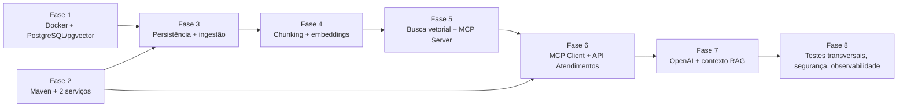

# Plano de Implementação — COTI AI Atendimento (MVP)

> Implementa [`02-requirements.md`](02-requirements.md) conforme
> [`03-architecture.md`](03-architecture.md) e [`06-api-contracts.md`](06-api-contracts.md),
> respeitando [`01-constitution.md`](01-constitution.md). As tarefas atômicas estão em
> [`05-tasks.md`](05-tasks.md).

## 1. Princípios do plano

1. **Fases em ordem de dependência.** Uma fase só começa quando os critérios de aceite das fases
   de que ela depende estiverem cumpridos.
2. **Testes junto com o código.** Toda fase entrega seus próprios testes (regra 10 do `AGENTS.md`).
   A Fase 8 **não** é "a fase dos testes": ela consolida o que é transversal (arquitetura,
   suíte adversarial, segurança, métricas e calibração).
3. **Cada tarefa segue Spec → Plan → Implement → Test → Review** e termina com `./mvnw verify`
   executado no serviço alterado e com o relatório do `AGENTS.md`.
4. **Sem código "para depois".** Cada fase adiciona só as dependências e as configurações de que
   precisa. Por exemplo, o starter da OpenAI entra na `api-conhecimento` apenas na Fase 4.
5. **Estados intermediários seguros.** Quando uma fase entrega parte de um fluxo, o comportamento
   provisório nunca inventa resposta. É o caso da Fase 6, em que toda pergunta com evidência
   recebe fallback até a Fase 7.

## 2. Mapa das fases



| Fase | Serviço principal | Requisitos atendidos | Tarefas |
|---|---|---|---|
| 1 | infra | RNF07, RNF09 | T001–T003 |
| 2 | ambos | RNF02 (base), RNF03, RNF05 (base), RNF07 | T004–T013 |
| 3 | `api-conhecimento` | RF01 (parcial), RNF01.2 | T014–T022 |
| 4 | `api-conhecimento` | RF01 (completo), RF02, RF03 | T023–T030 |
| 5 | `api-conhecimento` | RF04, RF05 | T031–T039 |
| 6 | `api-atendimentos` | RF06, RF07, RF10 (parcial), RNF02.4 | T040–T047 |
| 7 | `api-atendimentos` | RF08, RF09, RF10 (completo) | T048–T055 |
| 8 | ambos | RNF01, RNF02, RNF03.1, RNF03.5, RNF06, RNF08, ADR-014 | T056–T065 |

### 2.1 Pré-requisitos documentais

Não bloqueiam as Fases 1 e 2, mas devem estar prontos antes da Fase 3:

- **`specs/08-checklist.md`**, usado na etapa Review de cada tarefa.
- **`specs/07-test-plan.md`**, com a matriz critério de aceite → teste.
- **Skills alinhadas** ao contrato e à arquitetura:
  - nomes de campos: `chunkId`, `documentoId`, `texto`, `similaridade`, `fonte`;
  - chunker próprio com sobreposição;
  - ids `Tn` e escape de `<` e `>` no contexto.

---

## 3. Fases

### Fase 1 — Infraestrutura Docker e PostgreSQL/pgvector

**Objetivo.** Ter um PostgreSQL 16 com pgvector rodando localmente via Docker Desktop, configurado
somente por variáveis de ambiente.

**Dependências.** Docker Desktop instalado e ativo. Nenhuma fase anterior.

**Arquivos previstos.**
- `.env.example`, atualizado com todas as variáveis de `03-architecture.md`, seção 9.
- `infra/docker-compose.yml`.
- `.env`, local e **não versionado**, criado pelo desenvolvedor a partir do exemplo.

**Classes esperadas.** Nenhuma.

**Critérios de aceite.**
- O `docker compose config` valida o arquivo sem erros.
- O container `postgres` (`pgvector/pgvector:pg16`) fica `healthy` e publicado só em
  `127.0.0.1:5434`.
- A extensão `vector` aparece como disponível no banco `POSTGRES_DB`.
- O `.env` não é versionado, e o `.env.example` não contém valores reais.

**Comandos de validação.**
```bash
docker info
```
```bash
docker compose -f infra/docker-compose.yml --env-file .env config
```
```bash
docker compose -f infra/docker-compose.yml --env-file .env up -d
```
```bash
docker compose -f infra/docker-compose.yml --env-file .env ps
```
```bash
docker compose -f infra/docker-compose.yml --env-file .env exec postgres sh -c 'psql -U "$POSTGRES_USER" -d "$POSTGRES_DB" -c "SELECT name, default_version FROM pg_available_extensions WHERE name = '\''vector'\'';"'
```
```bash
git check-ignore .env
```

**Riscos técnicos.**
- A porta 5434 pode estar ocupada. Nesse caso, ajuste `POSTGRES_PORT` no `.env`.
- O Docker Desktop pode estar parado, o que bloqueia esta fase e os testes de integração
  seguintes. Se isso acontecer, registre nas pendências com o erro real (regra 14).
- Um volume antigo pode guardar credenciais diferentes das do `.env` atual. A solução é
  `docker compose down -v`, que apaga os dados locais.

---

### Fase 2 — Estrutura Maven e inicialização dos dois microsserviços

**Objetivo.** Criar o monorepo com os dois projetos Spring Boot independentes, que sobem nas portas
8081 e 8082 com Actuator, OpenAPI, logs estruturados, id de correlação e formato de erro
padronizado, ainda sem banco e sem IA.

**Dependências.** Nenhuma técnica (pode rodar em paralelo à Fase 1). Exige Java 21 e acesso ao
Maven Central.

**Arquivos previstos.**
- `pom.xml` (agregador), `mvnw`, `mvnw.cmd`, `.mvn/`.
- Em cada serviço (`api-conhecimento/` e `api-atendimentos/`):
  - `pom.xml`, `mvnw`, `mvnw.cmd`, `.mvn/`;
  - `src/main/resources/application.yml`;
  - a classe principal e os testes de inicialização.
- `infrastructure/web/` de cada serviço: filtro de correlação e handler de erros.

**Classes esperadas.**

| `api-conhecimento` | `api-atendimentos` |
|---|---|
| `ApiConhecimentoApplication` | `ApiAtendimentosApplication` |
| `infrastructure.web.CorrelationIdFilter` | `infrastructure.web.CorrelationIdFilter` |
| `infrastructure.web.GlobalExceptionHandler` | `infrastructure.web.GlobalExceptionHandler` |
| `controller.dto.ErroResponse` (ou extensões do `ProblemDetail`) | `controller.dto.ErroResponse` |
| `infrastructure.config.OpenApiConfig` | `infrastructure.config.OpenApiConfig` |
| Testes: `ApiConhecimentoApplicationTests`, `CorrelationIdFilterTest`, `GlobalExceptionHandlerTest` | Testes equivalentes |

**Critérios de aceite.**
- `./mvnw verify` passa em cada serviço e na raiz.
- Cada serviço sobe sozinho: `api-conhecimento` em `127.0.0.1:8081` e `api-atendimentos` em
  `127.0.0.1:8082`.
- `/actuator/health` responde `200` com os componentes visíveis e sem detalhes. `/v3/api-docs`
  responde `200`.
- Os logs saem no formato ECS (JSON).
- O `X-Correlation-Id` é aceito quando é um UUID válido, gerado quando ausente ou inválido, e
  sempre devolvido na resposta.
- Erros de rota inexistente, método, mídia, JSON malformado e erro interno saem como
  `application/problem+json`, com `codigo`, `correlationId` e `timestamp`, sem stack trace.
- O `maven-enforcer-plugin` da `api-atendimentos` bloqueia dependências de banco, vetor e
  migração (ADR-003).
- O patch exato do Spring Boot 4.1.x e do springdoc 3.x fica registrado em `03-architecture.md`,
  seção 2.

**Comandos de validação.**
```bash
cd api-conhecimento && ./mvnw verify
```
```bash
cd api-atendimentos && ./mvnw verify
```
```bash
./mvnw verify
```
```bash
cd api-conhecimento && ./mvnw spring-boot:run
```
```bash
curl -i http://localhost:8081/actuator/health
```
```bash
curl -i http://localhost:8082/v3/api-docs
```

**Riscos técnicos.**
- **Compatibilidade do springdoc com o Boot 4.1.** A matriz publicada cita o Boot 4.0.x. Se
  falhar, aplicar a saída prevista na ADR-002 (Boot 4.0.x com springdoc 3.0.x).
- **Mudanças do Boot 4.** Os starters foram modularizados (`spring-boot-starter-webmvc`, starters
  de teste por tecnologia) e o Jackson 3 trocou os pacotes. Exemplos antigos de Boot 3 não servem.
- **Mapeamento de erros.** O `ProblemDetail` precisa cobrir os erros que nascem antes do
  controller (404 e 405), o que pode exigir configuração extra do MVC.

---

### Fase 3 — Persistência e ingestão de conhecimento

**Objetivo.** Na `api-conhecimento`: migrações Flyway, tabela `conhecimento`, repositório com
`JdbcClient`, token administrativo e os endpoints `POST /api/conhecimentos`,
`GET /api/conhecimentos` e `GET /api/conhecimentos/{id}`, com validação e erros do contrato. O
POST persiste o documento; chunks e embeddings entram na Fase 4.

**Dependências.** Fases 1 e 2.

**Arquivos previstos.**
- `api-conhecimento/pom.xml`: incluir `postgresql`, starter JDBC, `spring-boot-starter-flyway`,
  `flyway-database-postgresql` e as dependências de Testcontainers.
- `src/main/resources/db/migration/V1__extensoes.sql` e `V2__conhecimento.sql`.
- `application.yml`: incluir datasource e `coti.admin.token`.
- Pacotes `domain/`, `application/`, `controller/`, `infrastructure/persistence`,
  `infrastructure/web` e `infrastructure/config`.
- Em `test/`: `support/PostgresTestcontainersConfig` e as classes `*IT`.

**Classes esperadas.**
- **Domínio:** `domain.model.Categoria`, `domain.model.Conhecimento`,
  `domain.port.ConhecimentoRepository`, `domain.exception.ConhecimentoNaoEncontradoException`.
- **Persistência:** `infrastructure.persistence.JdbcConhecimentoRepository`.
- **Configuração e web:** `infrastructure.config.AdminProperties`,
  `infrastructure.web.AdminTokenFilter`.
- **Aplicação:** `application.CadastrarConhecimentoService`,
  `application.ConsultarConhecimentoService`.
- **Controller:** `controller.ConhecimentoController`, com os DTOs
  `CadastrarConhecimentoRequest`, `ConhecimentoResponse`, `ConhecimentoResumo` e
  `PaginaConhecimentos`.
- **Testes:** `JdbcConhecimentoRepositoryIT`, `AdminTokenFilterTest`,
  `ConhecimentoControllerTest`, `ConhecimentoApiIT`, `MigracoesIT`.

**Critérios de aceite.**
- As migrações rodam do zero em um banco vazio (parte do CA03.4).
- CA01.2, CA01.3, CA01.4 e CA01.5 passam, e o `401` acontece antes da validação do corpo.
- CA01.7 (listagem paginada e filtrada) e CA01.8 (consulta por id e `404`) passam.
- `POST` válido → `201` com `Location`, e o documento fica persistido em `conhecimento`.
  **Parcial:** `quantidadeChunks` e o CA01.1 completo dependem da Fase 4.
- A aplicação não inicia sem `ADMIN_API_TOKEN`.

**Comandos de validação.**
```bash
docker info
```
```bash
cd api-conhecimento && ./mvnw verify
```
```bash
cd api-conhecimento && ./mvnw test -Dtest=AdminTokenFilterTest,ConhecimentoControllerTest
```

**Riscos técnicos.**
- **Docker para os testes.** A partir desta fase, o teste de carga de contexto da
  `api-conhecimento` precisa de Testcontainers, e portanto do Docker. Sem ele, `verify` falha.
- **Testcontainers 2.x.** O pacote do `PostgreSQLContainer` (`org.testcontainers.postgresql`) e
  o nome dos módulos mudaram em relação à versão 1.x.
- **Ordem dos filtros.** O filtro de token precisa rodar antes da desserialização, para que o `401`
  venha antes do `400`.
- **Mapeamento de tipos.** `text[]` para `tags` e `timestamptz` exigem mapeamento explícito no
  `JdbcClient`.

---

### Fase 4 — Chunking e geração de embeddings

**Objetivo.** Completar a ingestão: dividir o conteúdo em chunks de 800 tokens com 100 de
sobreposição, gerar embeddings com `text-embedding-3-small` (1536 dimensões) e persistir no
`PgVectorStore`, tudo de forma atômica junto com o registro do documento.

**Dependências.** Fase 3.

**Arquivos previstos.**
- `api-conhecimento/pom.xml`: incluir `spring-ai-starter-model-openai` e
  `spring-ai-starter-vector-store-pgvector`; `com.knuddels:jtokkit` só se não vier de forma
  transitiva.
- `db/migration/V3__vector_store.sql`.
- `application.yml`: incluir `spring.ai.model.chat=none`, embedding, pgvector, retry e
  `coti.chunking`.
- Pacote `infrastructure/chunking/`, `infrastructure/vector/` e, em `test/support/`, o
  `FakeEmbeddingModel`.

**Classes esperadas.**
- **Domínio:** `domain.model.Chunk`, `domain.port.Chunker`, `domain.port.ChunkStore`,
  `domain.exception.DependenciaIndisponivelException`.
- **Configuração:** `infrastructure.config.ChunkingProperties`.
- **Infraestrutura:** `infrastructure.chunking.TokenWindowChunker`,
  `infrastructure.vector.PgVectorChunkStore`.
- **Testes:** `FakeEmbeddingModel` (determinístico, 1536 dimensões), `TokenWindowChunkerTest`,
  `ChunkingPropertiesTest`, `PgVectorChunkStoreIT`, `CadastroAtomicoIT`.

**Critérios de aceite.**
- CA02.1, CA02.2, CA02.3 e CA02.4 passam, além de RN02.2: a concatenação dos chunks sem as
  sobreposições reconstrói o texto, inclusive com acentos.
- CA03.1: são gravados N registros com vetor de 1536 dimensões e os metadados completos.
- CA03.2: uma falha no segundo lote de embeddings faz rollback das duas tabelas.
- CA03.3: o mesmo `EmbeddingModel` atende a ingestão e a busca.
- CA03.4: as migrações completas rodam do zero.
- CA01.1 completo, com `quantidadeChunks` ≥ 1, e CA01.6 (`503 EMBEDDING_INDISPONIVEL`).
- O contexto sobe no teste sem chave real (`test-key`) e sem nenhum `ChatModel`.

**Comandos de validação.**
```bash
cd api-conhecimento && ./mvnw test -Dtest=TokenWindowChunkerTest,ChunkingPropertiesTest
```
```bash
cd api-conhecimento && ./mvnw verify
```

**Riscos técnicos.**
- **O `TokenTextSplitter` não tem sobreposição.** O chunker é próprio (ADR-009), e as fronteiras
  de token podem cortar caracteres UTF-8 multibyte. São necessários testes com acentos e emojis.
- **DDL da `vector_store`.** Ele precisa bater exatamente com o esperado pelo `PgVectorStore`
  2.0.1. Confira no Context7 e ligue a validação de tabela nos testes.
- **Transação aberta durante a chamada externa.** O rollback depende de o `PgVectorStore` usar o
  mesmo `DataSource` e participar do `@Transactional` (ADR-008). Isso deve ser confirmado em teste.
- **Nomes de propriedades.** A propriedade de timeout do cliente de embeddings pode não existir
  com esse nome no 2.0.1. A alternativa é um customizador do cliente HTTP.

---

### Fase 5 — Busca vetorial e MCP Server

**Objetivo.** Implementar a busca semântica com limiar e `topK`, o endpoint administrativo de
diagnóstico e a ferramenta MCP `buscar_conhecimento` via Streamable HTTP, conforme a seção 4 do
contrato.

**Dependências.** Fase 4.

**Arquivos previstos.**
- `api-conhecimento/pom.xml`: incluir `spring-ai-starter-mcp-server-webmvc`.
- `application.yml`: incluir `spring.ai.mcp.server.*`, `coti.rag.*` e
  `springdoc.paths-to-exclude`.
- Pacote `mcp/` e os DTOs de busca em `controller/dto`.

**Classes esperadas.**
- **Domínio:** `domain.model.ConsultaBusca` (com as regras de validação),
  `domain.model.Trecho`.
- **Configuração:** `infrastructure.config.RagProperties`.
- **Aplicação e infraestrutura:** `application.BuscaSemanticaService` e o método de busca do
  `PgVectorChunkStore`.
- **Controller:** `controller.BuscaDiagnosticoController`, com `BuscaSemanticaRequest`,
  `BuscaSemanticaResponse` e `TrechoConhecimento`.
- **MCP:** `mcp.BuscarConhecimentoTool`, com `mcp.dto.ResultadoBuscaMcp`, `TrechoMcp` e
  `ErroMcp`.
- **Testes:** `ConsultaBuscaTest`, `BuscaSemanticaServiceTest`, `BuscaSemanticaIT`,
  `BuscaDiagnosticoControllerTest`, `BuscarConhecimentoToolIT`, `McpToolContractIT`,
  `HealthIT`.

**Critérios de aceite.**
- CA04.1, CA04.2, CA04.3 e CA04.4 passam. Uma entrada inválida não chama o `EmbeddingModel`.
- `POST /api/conhecimentos/busca` segue a seção 3.4 do contrato, exige token e devolve
  `limiarSimilaridade`.
- CA05.1: o `tools/list` é igual ao da seção 4.2: `title`, `description`, `inputSchema` com
  limites e `default`, `outputSchema` e `annotations`.
- CA05.2 e CA05.3: o resultado vem em `structuredContent`, com `content[0]` equivalente, e uma
  lista vazia não é erro.
- CA05.4 e CA05.5: o resultado tem `isError: true` e `erro.codigo` conforme a seção 4.5.
- O `_meta.correlationId` aparece no MDC dos logs do servidor.
- O `/v3/api-docs` não contém `/mcp`.

**Comandos de validação.**
```bash
cd api-conhecimento && ./mvnw verify
```
```bash
cd api-conhecimento && ./mvnw verify -Dit.test=McpToolContractIT
```

**Riscos técnicos.**
- **Esquema gerado pelo `@McpTool`.** O `generateOutputSchema` e a geração do `inputSchema` podem
  não produzir `minLength`, `maximum` ou `default` iguais ao contrato. A alternativa é registrar a
  ferramenta de forma programática (`03-architecture.md`, seção 5.5).
- **`McpMeta`.** A leitura do `_meta` pelo parâmetro `McpMeta` precisa ser confirmada.
- **Embedding falso nos testes.** Com o `FakeEmbeddingModel`, a similaridade não é semântica. Os
  testes de relevância usam consultas idênticas ou quase idênticas aos chunks.
- **Escore.** O `Document.getScore()` precisa ser `1 − distância de cosseno` no `PgVectorStore`.
  Isso deve ser confirmado em teste.

---

### Fase 6 — MCP Client e API de Atendimentos

**Objetivo.** Na `api-atendimentos`: o endpoint `POST /api/atendimentos/perguntar`, o MCP Client
Streamable HTTP que chama `buscar_conhecimento` de forma **determinística**, o tratamento de
timeout e falhas (`503`), o fallback para resultado vazio e o health indicator do MCP.

**Dependências.** Fase 2 (estrutura) e Fase 5 (contrato MCP implementado e testado).

**Arquivos previstos.**
- `api-atendimentos/pom.xml`: incluir `spring-ai-starter-mcp-client`, e o
  `spring-ai-starter-mcp-server-webmvc` **só com escopo de teste**, para o servidor MCP falso.
- `application.yml`: incluir `spring.ai.mcp.client.*` e `coti.rag.*`/`coti.atendimento.*`.
- Pacotes `domain/`, `application/`, `controller/` e `infrastructure/mcp`.
- `test/support/FakeMcpServerApplication`.

**Classes esperadas.**
- **Domínio:** `domain.model.Pergunta`, `Evidencia`, `Resposta`, `Fonte` e `Desfecho`;
  `domain.port.BuscadorDeConhecimento`; `domain.exception.ConhecimentoIndisponivelException`.
- **Configuração:** `infrastructure.config.AtendimentoProperties` e `RagProperties`.
- **MCP:** `infrastructure.mcp.McpBuscadorDeConhecimento` (com `dto/`) e
  `infrastructure.mcp.McpConhecimentoHealthIndicator`.
- **Aplicação:** `application.ResponderPerguntaService`, em versão parcial.
- **Controller:** `controller.AtendimentoController`, com `PerguntaRequest`,
  `RespostaAtendimentoResponse` e `FonteResposta`.
- **Testes:** `FakeMcpServerApplication`, `McpBuscadorDeConhecimentoIT`,
  `ResponderPerguntaServiceTest`, `AtendimentoControllerTest`, `McpHealthIndicatorIT`.

**Critérios de aceite.**
- CA06.1, CA06.2, CA06.3 e CA06.4 (o cabeçalho de correlação é devolvido).
- CA07.1: `buscar_conhecimento` é chamada exatamente uma vez, com `limite = RAG_TOP_K` e
  `_meta.correlationId`.
- CA07.2, CA07.3 e CA10.3/CA10.4: timeout, `isError`, conexão recusada e esquema inválido geram
  `503 CONHECIMENTO_INDISPONIVEL`, com `Retry-After`.
- CA07.4: a árvore de dependências não tem banco, vetor nem embedding (o enforcer passa).
- CA10.1 (parcial): resultado vazio gera `200` com fallback, `fontes = []`.
- **Provisório seguro:** uma pergunta com evidência também recebe fallback até a Fase 7, sem
  chamar nenhum modelo.
- O health `mcpConhecimento` fica `UP` com o servidor ativo e `DOWN` sem ele (`503`), com timeout
  de 2 s e cache de 10 s.
- A aplicação sobe mesmo com a `api-conhecimento` fora do ar (`initialized: false`).

**Comandos de validação.**
```bash
cd api-atendimentos && ./mvnw verify
```
```bash
cd api-atendimentos && ./mvnw dependency:tree
```

**Riscos técnicos.**
- **API do SDK MCP.** A assinatura de `CallToolRequest` e a leitura de `structuredContent` podem
  diferir entre versões. Confira no Context7.
- **Inicialização preguiçosa.** Com `initialized: false`, o cliente precisa chamar `initialize()`
  de forma preguiçosa e segura entre threads.
- **Servidor falso com o starter de server.** Usar o starter de MCP Server nos testes da
  `api-atendimentos` exige cuidado para não vazar para o classpath principal (escopo `test`, com o
  enforcer configurado).
- **Timeout testável.** O timeout depende de `request-timeout`. O servidor falso precisa simular o
  atraso de forma controlada, sem `Thread.sleep` no teste.

---

### Fase 7 — Integração com OpenAI e montagem do contexto RAG

**Objetivo.** Completar o fluxo B:
- normalizar os trechos e montar o contexto, com escape, limite de 12.000 caracteres e ids `Tn`;
- usar os prompts versionados;
- chamar o `ChatClient` sem ferramentas, com saída estruturada;
- derivar as fontes só a partir dos trechos recuperados;
- aplicar o fallback e devolver `503 MODELO_INDISPONIVEL` quando o modelo falhar.

**Dependências.** Fase 6.

**Arquivos previstos.**
- `api-atendimentos/pom.xml`: incluir `spring-ai-starter-model-openai`.
- `application.yml`: incluir `spring.ai.model.embedding=none`, o modelo de chat, a temperatura,
  o retry e o timeout.
- `src/main/resources/prompts/sistema.st` e `usuario.st`.
- `domain/service/`, `infrastructure/ai/` e, em `test/support/`, o `StubChatModel`.

**Classes esperadas.**
- **Domínio:** `domain.model.ContextoRag`, `TrechoContexto` e `SaidaModelo`;
  `domain.service.MontadorDeContexto` e `domain.service.DerivadorDeFontes`;
  `domain.port.GeradorDeResposta`; `domain.exception.ModeloIndisponivelException`.
- **IA:** `infrastructure.ai.ChatClientConfig` e `infrastructure.ai.ChatClientGeradorDeResposta`.
- **Aplicação:** `application.ResponderPerguntaService`, em versão completa.
- **Testes:** `MontadorDeContextoTest`, `DerivadorDeFontesTest`, `PromptsTest`,
  `ChatClientGeradorDeRespostaTest`, `ResponderPerguntaServiceTest` (com todos os desfechos),
  `AtendimentoFluxoIT`.

**Critérios de aceite.**
- Montagem do contexto (seção 6.3 do contrato):
  - escape de `<` e `>`;
  - trechos inteiros, sem truncar, até 12.000 caracteres;
  - deduplicação e ordenação (nulos por último);
  - ids `T1…Tn`;
  - CA08.2.
- CA08.1, CA08.3, CA08.4 e CA08.5 passam.
- CA09.1, CA09.2 e CA09.3: as fontes vêm só dos trechos recuperados, e os ids inexistentes são
  descartados.
- CA10.1, CA10.2, CA10.5 e CA10.6: no fallback sem evidência, `verify(chatModel, never())`;
  falhas e saída inválida geram `503 MODELO_INDISPONIVEL`.
- O `ChatClient` não tem nenhuma ferramenta registrada, e não existe nenhum bean de
  `EmbeddingModel` na `api-atendimentos`.
- O IT ponta a ponta (servidor MCP falso + `StubChatModel`) devolve as respostas da seção 5.1 do
  contrato.
- Opcional e manual: uma execução real com a OpenAI e os dois serviços, com o resultado
  registrado no relatório.

**Comandos de validação.**
```bash
cd api-atendimentos && ./mvnw verify
```
```bash
cd api-atendimentos && ./mvnw test -Dtest=MontadorDeContextoTest,DerivadorDeFontesTest
```
```bash
curl -s -X POST http://localhost:8082/api/atendimentos/perguntar -H "Content-Type: application/json" -d "{\"pergunta\":\"Quais os pré-requisitos do curso Java Web Developer?\"}"
```

**Riscos técnicos.**
- **Saída estruturada.** O `entity(SaidaModelo.class)` pode falhar com o modelo real (JSON
  inválido). O caminho de `503` precisa estar coberto, e pode-se avaliar a saída estruturada
  nativa da OpenAI (`useProviderStructuredOutput`).
- **Exceções do Spring AI.** Os tipos lançados no 2.0.1 (transitórias, não transitórias, timeout,
  conversão) precisam ser confirmados para o mapeamento ficar correto.
- **Template.** O template `.st` usa `{}` como delimitador de variáveis. O conteúdo dos trechos
  passa como parâmetro, nunca concatenado no template, para não quebrar a renderização.
- **Comportamento real do modelo.** O comportamento com a OpenAI real (aderência às regras do
  prompt) não é coberto pelo `verify`. Ele é avaliado de forma manual (Fase 8, T064).

---

### Fase 8 — Testes, segurança e observabilidade

**Objetivo.** Consolidar os requisitos transversais:
- testes de arquitetura (ArchUnit);
- suíte adversarial de prompt injection;
- contrato OpenAPI;
- logs seguros e correlação ponta a ponta;
- métricas;
- verificações de segurança;
- calibração do limiar;
- revisão final contra a constituição e o checklist.

**Dependências.** Fase 7, e `specs/08-checklist.md` e `specs/07-test-plan.md` escritos.

**Arquivos previstos.**
- Dependência de teste `archunit-junit5` nos dois serviços.
- `test/.../architecture/` nos dois serviços.
- `test/resources/adversarial/` na `api-atendimentos`.
- Anotações OpenAPI nos controllers e DTOs.
- Configuração de métricas.
- `03-architecture.md` (ADR-014), atualizado com o limiar calibrado.
- `specs/07-test-plan.md`, atualizado com a matriz preenchida.

**Classes esperadas.**
- **Testes:** `CamadasArchTest` (nos dois serviços), `ProibicoesArchTest` (`api-atendimentos`),
  `SuiteAdversarialTest`, `OpenApiContractIT` (nos dois), `LogSeguroTest` (nos dois),
  `CorrelacaoPontaAPontaIT`, `ErroSemVazamentoTest`.
- **Métricas:** `infrastructure.config.MetricasAtendimento`, ou métricas registradas no próprio
  serviço com `MeterRegistry`.
- **Configuração:** `infrastructure.config.LogConteudoGuard`, que impede o log de conteúdo fora do
  perfil `dev`.

**Critérios de aceite.**
- **Arquitetura:** o ArchUnit passa. O domínio não depende de web, JDBC nem MCP, e a
  `api-atendimentos` não usa JDBC, `VectorStore` nem `EmbeddingModel`.
- **Prompt injection (RNF08.5):** a suíte cobre:
  - ordem para ignorar as regras;
  - fechamento de delimitador;
  - pedido do prompt de sistema;
  - preço inexistente.
- **Logs (CA06.5):** com a configuração padrão, os logs não contêm a pergunta, a resposta, o
  conteúdo, o token nem a chave. O log de conteúdo só funciona no perfil `dev`.
- **Correlação:** o mesmo `correlationId` aparece nos logs dos dois serviços.
- **Métricas (RNF02.3):** `coti.atendimento.desfecho`, `coti.atendimento.fontes.descartadas`,
  `coti.mcp.chamada` e os timers por etapa ficam expostos em `/actuator/metrics`.
- **OpenAPI:** o `/v3/api-docs` de cada serviço contém exatamente os endpoints do contrato, com
  exemplos, e não contém `/mcp`.
- **Segurança:**
  - CA10.7 (erro sem vazamento);
  - nenhum segredo no repositório;
  - Actuator restrito a `health`, `info` e `metrics`.
- **Calibração (ADR-014):** o limiar é calibrado com um conjunto de perguntas de referência e
  registrado na arquitetura.
- **Revisão final:** o checklist (`08-checklist.md`) está completo, e o `./mvnw verify` da raiz
  passa.

**Comandos de validação.**
```bash
./mvnw verify
```
```bash
cd api-atendimentos && ./mvnw test -Dtest=SuiteAdversarialTest,ProibicoesArchTest
```
```bash
git grep -nE "sk-[A-Za-z0-9]{20,}|OPENAI_API_KEY=.+" -- . ":!*.example"
```
```bash
curl -s http://localhost:8082/actuator/metrics/coti.atendimento.desfecho
```

**Riscos técnicos.**
- **Testes de log.** Capturar a saída (`OutputCaptureExtension`) com logs JSON pode ser frágil. As
  asserções devem procurar marcadores únicos da pergunta de teste.
- **Calibração.** A calibração do limiar exige a OpenAI real (custo) e uma base representativa. Sem
  ela, o limiar 0,70 pode gerar fallback em excesso.
- **ArchUnit e Spring AI.** As regras precisam permitir o `Document` do Spring AI só nos
  adaptadores da `api-conhecimento`.
- **Varredura de segredos.** Usar `gitleaks`, se estiver instalado. Na falta dele, o `git grep` é
  uma verificação parcial, e isso deve ser registrado no relatório.

---

## 4. Rastreabilidade fase × requisito

| Requisito | F1 | F2 | F3 | F4 | F5 | F6 | F7 | F8 |
|---|:-:|:-:|:-:|:-:|:-:|:-:|:-:|:-:|
| RF01 | | | ◐ | ● | | | | |
| RF02 | | | | ● | | | | |
| RF03 | ◐ | | | ● | | | | |
| RF04 | | | | | ● | | | |
| RF05 | | | | | ● | | | |
| RF06 | | ◐ | | | | ● | | |
| RF07 | | | | | | ● | | |
| RF08 | | | | | | | ● | ◐ |
| RF09 | | | | | | | ● | |
| RF10 | | ◐ | | ◐ | ◐ | ◐ | ● | |
| RNF01 Segurança | ◐ | ◐ | ◐ | | | | | ● |
| RNF02 Observabilidade | | ◐ | | | ◐ | ◐ | | ● |
| RNF03 Manutenibilidade | | ● | | | | | | ● |
| RNF04 Timeouts | | | | ◐ | | ● | ● | |
| RNF05 Validação | | ◐ | ● | | ● | ● | | |
| RNF06 Testabilidade | | ● | ● | ● | ● | ● | ● | ● |
| RNF07 Separação | ● | ● | | | | ● | | ● |
| RNF08 Prompt injection | | | | | | | ● | ● |
| RNF09 Variáveis de ambiente | ● | ● | ● | ● | ● | ● | ● | |

● entrega principal · ◐ entrega parcial ou base
